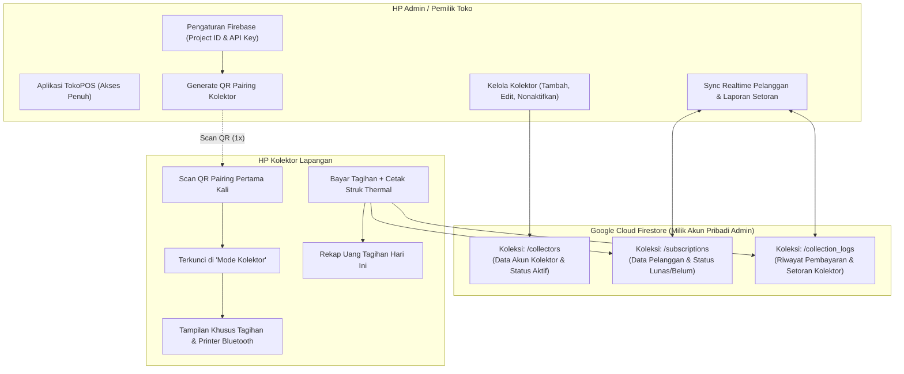

# Rencana Implementasi: Fitur Multi-Device Tagihan Kolektor (Custom Firebase Sync)

Dokumen ini adalah panduan arsitektur dan langkah kerja bertahap untuk menerapkan fitur **Penagihan Lapangan via HP Kolektor** dengan **Sinkronisasi Otomatis Realtime ke HP Admin** menggunakan **Google Firebase Firestore** (Pendekatan A: Beda Admin Beda Akun Firebase Pribadi).

---

## 1. Ikhtisar Arsitektur



---

## 2. Struktur Data Baru

### A. Model `FirebaseConfig` (Disimpan di DataStore / SharedPreferences)
```kotlin
data class FirebaseSyncConfig(
    val isEnabled: Boolean = false,
    val projectId: String = "",
    val apiKey: String = "",
    val applicationId: String = "",
    val lastSyncTimestamp: Long = 0L
)
```

### B. Model `Collector` (Entitas SQLite Room & Firestore)
```kotlin
data class Collector(
    val id: String, // UUID atau KOL-xxxx
    val name: String, // Contoh: "Andi Lapangan"
    val phone: String, // "0812xxxx"
    val assignedArea: String = "", // Contoh: "RT 01 - RT 04"
    val isActive: Boolean = true, // Jika false, kolektor tidak bisa akses
    val createdAt: Long = System.currentTimeMillis()
)
```

### C. Ekstensi Model `SubscriptionCustomer` (Tambahan Field Kolektor)
Field tambahan pada data tagihan pelanggan:
- `lastCollectedBy`: String? (Nama/ID Kolektor yang menerima pembayaran)
- `lastPaymentDate`: Long?
- `depositStatus`: String ("SETOR", "BELUM_SETOR")
- `syncStatus`: String ("SYNCED", "PENDING_SYNC")

### D. Model `CollectorDepositLog` (Rekap Setoran Harian)
```kotlin
data class CollectorDepositLog(
    val id: String,
    val collectorId: String,
    val collectorName: String,
    val customerId: String,
    val customerName: String,
    val amountPaid: Long,
    val paidAt: Long,
    val isDepositedToAdmin: Boolean = false, // Menandai apakah uang fisik sudah disetor ke kasir
    val depositedAt: Long? = null
)
```

---

## 3. Langkah-Langkah Pengerjaan Bertahap (Phased Roadmap)

### Tahap 1: Setup Dependensi & Dynamic Firebase Client
- [ ] Menambahkan dependensi Google Firebase Firestore SDK ke `app/build.gradle.kts`.
- [ ] Membuat class helper `DynamicFirebaseManager.kt`:
  - Menginisialisasi FirebaseApp secara dinamis menggunakan `FirebaseOptions` runtime (API Key, Project ID, App ID yang dimasukkan Admin tanpa wajib menempelkan static `google-services.json`).
  - Menangani mode offline-persistence Firestore (agar saat di daerah tanpa sinyal HP, kolektor tetap bisa bayar).

### Tahap 2: Antarmuka Pengaturan Cloud Admin
- [ ] Menambahkan halaman / dialog **"Pengaturan Cloud Sync"** di menu Pengaturan Admin.
- [ ] Menyediakan form input ringkas:
  - Project ID
  - API Key
  - App ID
  - *(Opsional: Tombol "Paste JSON Config" dari Firebase Web Console)*
- [ ] Indikator status koneksi (*"Terhubung ke Cloud"* / *"Offline"*).

### Tahap 3: Manajemen Kolektor di Admin (CRUD + QR Pairing)
- [ ] Membuat halaman **"Kelola Kolektor"** di dalam menu Pengaturan / Tagihan Admin:
  - Daftar kolektor aktif & nonaktif.
  - Tombol **"Tambah Kolektor"** (Nama, No HP, Wilayah).
  - Tombol **"Edit / Nonaktifkan Kolektor"**.
  - Tombol **"Tautkan HP (QR Pairing)"**: Menampilkan dialog dengan QR Code besar yang berisi payload JSON terenkripsi/terformat:
    ```json
    {
      "type": "TOKOPOS_COLLECTOR_PAIRING",
      "projectId": "...",
      "apiKey": "...",
      "appId": "...",
      "collectorId": "KOL-1234",
      "collectorName": "Andi Lapangan"
    }
    ```

### Tahap 4: Mode Kolektor di HP Petugas Lapangan
- [ ] Menambahkan opsi aktivasi di splash screen / menu awal: **"Masuk Sebagai Kolektor"**.
- [ ] Pemindai Kamera QR untuk membaca QR Pairing Admin.
- [ ] Saat berhasil:
  - Menyimpan profil kolektor di DataStore lokal.
  - Mengunci antarmuka aplikasi ke **"Mode Kolektor"**:
    - Navbar bawah disederhanakan (Hanya ada tab **Tagihan** & **Printer**).
    - Menu Kasir POS, Inventaris Stok, Laba Rugi, dan Pengaturan Toko disembunyikan.
    - Header menampilkan identitas petugas (*"Petugas Kolektor: Andi"*).

### Tahap 5: Sinkronisasi Tagihan & Aksi Bayar di Lapangan
- [ ] Menghubungkan pembacaan realtime `SubscriptionCustomer` antara database Room lokal dan Firestore.
- [ ] Saat Kolektor menekan **"Bayar Tagihan"**:
  - Update status pelanggan menjadi **LUNAS**.
  - Catat riwayat di `CollectorDepositLog`.
  - Cetak struk pembayaran thermal via Bluetooth dengan keterangan nama kolektor.
  - Kirim mutasi ke Firestore.
- [ ] HP Admin yang mendengarkan perubahan (*snapshot listener*) secara otomatis merubah status pelanggan tersebut menjadi **Lunas** detik itu juga.

### Tahap 6: Rekap Setoran Uang Harian
- [ ] **Di HP Kolektor**:
  - Banner ringkasan di atas daftar tagihan:
    *"Total Tagihan Hari Ini: 15 Pelanggan (Rp 1.500.000) - Belum Disetor"*.
- [ ] **Di HP Admin**:
  - Tab / Rekap: *"Penerimaan Kolektor Hari Ini"*.
  - Rincian per nama kolektor dengan tombol **"Terima Setoran"** untuk mengonfirmasi bahwa uang fisik telah diterima oleh admin/kasir.

---

## 4. Keamanan & Kebijakan Data (Play Store Compliance)
- Kolektor **tidak memiliki hak akses** membaca data modal HPP, laporan keuangan toko, atau daftar transaksi POS kasir.
- Komunikasi menggunakan TLS terenkripsi standar Google Firebase Firestore.
- Tidak ada data yang dibagikan ke pihak ketiga selain akun Google Firebase milik Admin sendiri.

---

## 5. Rencana Pengujian (Verification Plan)
1. **Tes Koneksi Dinamis**: Memasukkan Project ID dan API Key di HP Admin, memverifikasi koneksi sukses ke Firestore.
2. **Tes QR Pairing**: Menampilkan QR di Admin, scan menggunakan HP kedua (Kolektor), memverifikasi mode kolektor terkunci dengan benar.
3. **Tes Pembayaran & Sinkronisasi Realtime**:
   - HP Kolektor membayar tagihan Pelanggan A.
   - Memastikan HP Admin otomatis berubah statusnya menjadi "Lunas" tanpa perlu restart aplikasi.
   - Memastikan cetak struk thermal di HP Kolektor keluar dengan rapi.
4. **Tes Offline Recovery**:
   - Matikan internet HP Kolektor, lakukan transaksi bayar.
   - Hidupkan kembali internet, pastikan transaksi otomatis tersinkronisasi ke Cloud & HP Admin.
